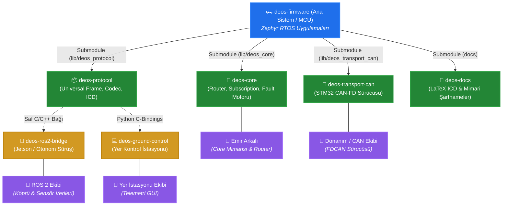

# 🏎️ DEOS Firmware

DEOS Firmware, Zephyr RTOS üzerinde koşan, modüler donanım mimarisine ve gelişmiş iletişim (CAN-FD, LoRa, Ethernet vb.) altyapılarına sahip dağıtık araç içi gömülü kontrol yazılımıdır.

Proje, donanım bağımsız (hardware-agnostic) bir yapıda geliştirilmiş olup, Zephyr'in **T2 Workspace Topology (Application as a Manifest Repository)** standartlarına ve modüler Git Submodule mimarisine tam uyumludur.

---

## 🏛️ Dağıtık Sistem Mimarisi ve Ekosistem Ağacı

DEOS ekosistemi; gömülü mikrodenetleyiciler (STM32), otonomi bilgisayarı (ROS 2 / Jetson), yer kontrol istasyonu ve dokümantasyon birimlerinin bağımsız yönetildiği modüler bir **Git Submodule** mimarisine sahiptir:



---

## 📦 Alt Modüller (Git Submodules) ve Depo Sözlüğü

DEOS projesi "Monorepo" karmaşasını önlemek ve her birimin yalnızca ihtiyacı olan kodları çekmesini sağlamak amacıyla 4 bağımsız depoya ayrılmıştır:

### 1. 🧠 [`lib/deos_core`](https://github.com/DEUDEOS-Team/deos-core) (Düğüm İcra Motoru)
- **Rol:** STM32 üzerindeki işletim motorudur. Zephyr RTOS'a bağlıdır.
- **Sorumluluklar:**
  - **Router (Yönlendirici):** Split-Horizon kuralları ile CAN, LoRa, Ethernet ve Yerel kuyruklar arasında sıfır gecikmeli paket aktarımı.
  - **Subscription Engine (Abonelik Motoru):** Periyodik veya Olay Tabanlı (On-Change) telemetri dağıtımı ve TTL kontrolü.
  - **Fault Registry (Hata Tablosu):** Düğüm bazında mandallanan arıza kayıtları ve `GET_FAULTS` akışı.
  - **Hosted Local Nodes:** Tek bir MCU üzerinde birden fazla mantıksal düğüm çalıştırma yeteneği.

### 2. 📦 [`lib/deos_protocol`](https://github.com/DEUDEOS-Team/deos-protocol) (İletişim & Tel Protokolü)
- **Rol:** Saf ANSI C99 (Zero-Dependency) tel protokolü ve serileştirme kütüphanesidir.
- **Sorumluluklar:**
  - **Universal Frame:** 9-baytlık ortamdan bağımsız paket kodlama/çözme (`UNIVERSAL_9B`).
  - **Portable Codec:** Donanım bağımsız Little-Endian bayt paketleme (`deos_put_u16_le` vb.).
  - **Registry Engine:** Dinamik bellek (`malloc`) kullanmayan reentrant mesaj işleyici tablosu.
  - **Python C-Bindings:** `python/deos.py` ile yer istasyonu ve test scriptlerinin C kütüphanesini doğrudan çalıştırması.
  - **Kullanıcılar:** STM32, ROS 2 C++ köprüsü, Yer İstasyonu (Python/Qt) ve test betikleri.

### 3. 🔌 [`lib/deos_transport_can`](https://github.com/DEUDEOS-Team/deos-transport-can) (CAN-FD Sürücüsü)
- **Rol:** CAN-FD donanım katmanının çekirdekten izole edilmiş taşıyıcı sürücüsüdür.
- **Sorumluluklar:**
  - **29-bit CAN ID Maskeleme:** Öncelik (Priority), Sınıf (Class), Servis, Hedef ve Kaynak bitlerinin CAN çerçevesine paketlenmesi.
  - **Donanımsal Filtreler:** STM32 FDCAN donanım filtrelerinin otomatik kurulumu.
  - **Non-blocking TX/RX:** Mesaj kuyrukları ile kesintisiz bus iletişimi.

### 4. 📑 [`docs`](https://github.com/DEUDEOS-Team/deos-docs) (Merkezi Dokümantasyon & ICD)
- **Rol:** Araç içi ve araç dışı haberleşme standartlarının resmi şartname deposudur.
- **Sorumluluklar:**
  - **Resmi LaTeX ICD Kaynakları:** Servis, komut ve veri tiplerinin PDF şartnameleri.
  - **Ağ Mimarisi & Bilgi Tabanı:** Zero-latency optimizasyonları ve topoloji kuralları.
  - **ROS 2 Topic Standartları:** Otonom sürüş ve sensör topic sözleşmeleri.

---

## 🚗 Araç İçi Düğümler (Firmware Apps)

| Düğüm Klasörü | Düğüm Kimliği | Sorumlu Olduğu Görev |
| :--- | :--- | :--- |
| **`apps/main_node`** | `0x03` (`MAIN_STM32`) | Araç Ana Ağ Geçidi, IMU Sensörü, LoRa Yer İstasyonu İletişimi, Ethernet ROS 2 Köprüsü |
| **`apps/traction`** | `0x10` (`TRACTION`) | Çekiş / İnvertör Kontrolörü, Hız ve Tork Yönetimi |
| **`apps/steering`** | `0x11` (`STEERING`) | Steer-by-Wire Direksiyon Açısı ve Mod Yönetimi |
| **`apps/bms_gateway`** | `0x30` (`BMS_GATEWAY`)| Batarya Yönetim Sistemi (BMS) Hücre Voltaj ve Sıcaklık İletişimi |
| **`apps/dummy_*`** | Test Düğümleri | Masaüstü simülasyonları ve donanımsız hat test araçları |

---

## 🚀 Kurulum ve İlk Adımlar

DEOS Firmware, kendi içerisinde bir Zephyr manifestosu (`west.yml`) barındırır. Bu sayede gerekli olan Zephyr çekirdeği ve dış modüller otomatik olarak indirilir.

Projeyi bilgisayarınıza kurmak için standart `git clone` **yerine** aşağıdaki Zephyr komutlarını kullanmanız gerekir:

```bash
# 1. Projeyi indireceğiniz yeni bir çalışma alanı (workspace) oluşturun
west init -m https://github.com/DEUDEOS-Team/deos-firmware.git deos_workspace

# 2. Çalışma alanına girin
cd deos_workspace

# 3. Bağımlılıkları, Zephyr çekirdeğini ve modülleri otomatik indirin
west update
```

Bu komutlardan sonra Zephyr ortamınız ve gerekli tüm modüller inmiş ve derlenmeye hazır olacaktır.

---

## 🛠️ Proje Yönetimi (Tavsiye Edilen Araç)

Zephyr projelerinin ortam kurulumu, derlenmesi (build) ve karta yüklenmesi (flash) gibi işlemler bazen karmaşık olabilir. 

Tüm bu süreçleri otomatize etmek ve geliştirme hızınızı artırmak için **[Zephyr Project Manager](https://github.com/emirarkali/Zephyr-Project-Manager)** aracını bilgisayarınıza indirip kullanmanızı şiddetle tavsiye ederiz. Bu araç sayesinde terminalde uzun komutlar yazmadan projelerinizi kolayca yönetebilirsiniz.

---

## 🧩 Overlay (Donanım Soyutlama) Mimarisi

DEOS projesi, kodların farklı donanım kartlarında (örneğin NUCLEO-H563ZI veya NUCLEO-H7A3ZI-Q) **hiçbir C++ kodu değiştirilmeden** çalışabilmesi için kusursuz bir Device Tree (Overlay) mimarisine sahiptir.

Projeye yeni bir donanım veya kart eklerken aşağıdaki kurallara kesinlikle uyulmalıdır:

### 1. `app.overlay` (İskelet Dosyası)
Uygulamanın ana klasöründe bulunur. Görevi sadece projenin **donanımdan bağımsız iskeletini** kurmaktır.
- Burada fiziksel pin atamaları **YAPILMAZ** (Örn: `&gpioe 14` yazılamaz).
- Hangi UART kanalının (`usart1`, `lpuart1` vb.) kullanılacağı **BELİRTİLMEZ**.
- Sadece uygulamada kullanılacak sanal modüller (node) ve etiketler (label) tanımlanır.

### 2. `boards/` İçindeki Overlay Dosyaları (Karta Özel Dosyalar)
Elinizdeki fiziksel kartın adıyla aynı olan dosyalardır (Örn: `nucleo_h563zi.overlay`).
- `app.overlay` dosyasında oluşturulan iskeletin, **sizin kartınızdaki hangi fiziksel pinlere** takıldığını belirttiğiniz yerdir.
- UART portu seçimleri, baud rate hız ayarları, CAN-FD RX/TX pin atamaları tamamen bu dosyada yapılır.
- Derleme sırasında (`west build -b nucleo_h563zi`) Zephyr, önce `app.overlay` iskeletini okur, sonra gidip `boards/nucleo_h563zi.overlay` içindeki fiziksel pinleri bu iskelete giydirir.

Örnek bir derleme komutu:
```bash
west build -b nucleo_h563zi apps/main_node
```

> **Not:** Sistem mimarisinin derinlikleri, ağ iletişimi (network routing) ve sıfır gecikme (zero-latency) optimizasyonları hakkında daha fazla bilgi edinmek için lütfen `docs/DEOS_ARCHITECTURE_KNOWLEDGE.md` dosyasını okuyun.
