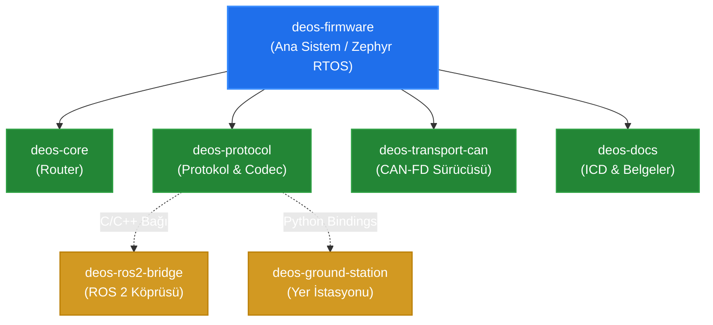
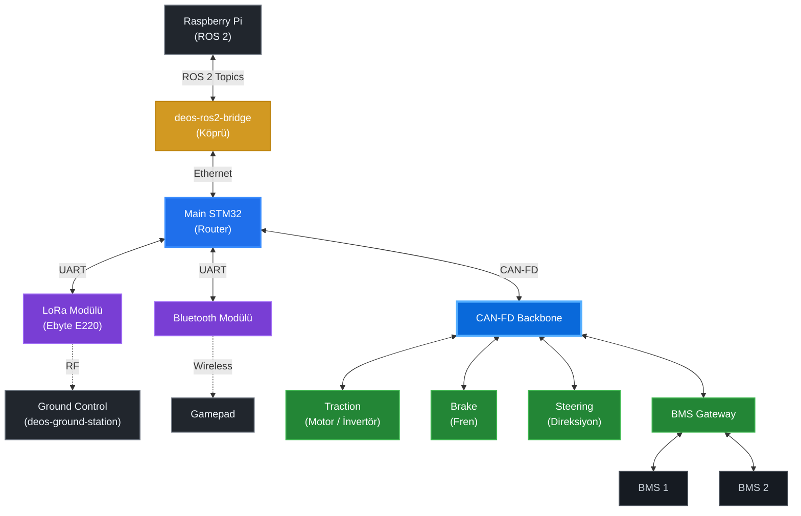

# 🏎️ DEOS Firmware

DEOS Firmware, Zephyr RTOS üzerinde koşan, modüler donanım mimarisine ve gelişmiş iletişim (CAN-FD, LoRa, Ethernet vb.) altyapılarına sahip dağıtık araç içi gömülü kontrol yazılımıdır.

Proje, donanım bağımsız (hardware-agnostic) bir yapıda geliştirilmiş olup, Zephyr'in **T2 Workspace Topology (Application as a Manifest Repository)** standartlarına ve modüler Git Submodule mimarisine tam uyumludur.

---

## 1. Yazılım ve Git Alt Modül Mimarisi

DEOS ekosistemi; modüler Git alt modülleri ve sistem mimarisine sahiptir:



---

## 2. Araç İçi Donanım ve Haberleşme Topolojisi

Host bilgisayar, kablosuz telemetri hatları ve CAN-FD omurgası üzerindeki donanım düğümleri:



---

## Ekosistem Depoları ve Sorumluluk Tablosu

DEOS projesi modüler bir mimaride yönetilmektedir. Tüm depoların ve uygulamaların anlık canlı commit geçmişini [**DEOS Mimari Portalı**](https://deudeos-team.github.io/deos-software-development-page/)'ndan takip edebilirsiniz:

| Depo / Bileşen / Klasör | Konum / Rol | Sorumlu | Açıklama |
| :--- | :--- | :--- | :--- |
| [**`deos-firmware`**](https://github.com/DEUDEOS-Team/deos-firmware) | Ana Depo | **Emir Arkalı** | Zephyr RTOS uygulamaları ve alt modül manifestosu |
| [**`deos-core`**](https://github.com/DEUDEOS-Team/deos-core) | Alt Modül (`lib/deos_core`) | **Emir Arkalı** | Split-Horizon yönlendirici motoru, telemetri abonelikleri ve arıza tablosu |
| [**`deos-protocol`**](https://github.com/DEUDEOS-Team/deos-protocol) | Alt Modül (`lib/deos_protocol`) | **Emir Arkalı** | ANSI C99 Universal Frame codec ve Python C-Bindings kütüphanesi |
| [**`deos-transport-can`**](https://github.com/DEUDEOS-Team/deos-transport-can) | Alt Modül (`lib/deos_transport_can`) | **Emir Arkalı** | STM32 FDCAN sürücüsü ve 29-bit CAN ID filtreleme motoru |
| [**`deos-ground-station`**](https://github.com/DEUDEOS-Team/deos-ground-station) | Yer Kontrol İstasyonu | **Alper Bora** | PyQt tabanlı telemetri ve komuta kontrol masaüstü yazılımı |
| [**`deos-ros2-bridge`**](https://github.com/DEUDEOS-Team/deos-ros2-bridge) | Otonomi Köprüsü | **Sepehr Jafarzadeh** | Raspberry Pi üzerinde koşan ROS 2 Humble ile araç içi CAN köprüsü |
| [**`deos-software-development-page`**](https://github.com/DEUDEOS-Team/deos-software-development-page) | Web Portalı | **DEUDEOS Ekibi** | Canlı sistem mimarisi, donanım topolojisi ve commit takip sitesi |
| **`Raspberry Pi (ROS 2)`** | Otonomi Bilgisayarı | **Arda Efe Yılmaz** | Otonom sürüş algoritmaları, sensör füzyonu ve ROS 2 paketleri |
| **`apps/traction`** | CAN Düğümü (0x10) | **Alper Altındaş** | Çekiş / İnvertör kontrolü, tork ve hız talepleri |
| **`apps/brake`** | CAN Düğümü (0x12) | **Alper Altındaş** | Fren aktüatörü kontrolü, hidrolik basınç ve güvenlik |
| **`apps/steering`** | CAN Düğümü (0x11) | **Alper Altındaş** | Steer-by-Wire direksiyon açı kontrolü ve enkoder takibi |
| **`apps/bms_gateway`** | CAN Düğümü (0x30) | **Ayşe Ceren Akdamar** | Batarya yönetim sistemi ağ geçidi, hücre voltaj ve sıcaklık takibi |
| **`apps/main_node`** | CAN Düğümü (0x03) | **Emir Arkalı** | Araç içi merkezi ağ geçidi ve yönlendirici (Nucleo-H563ZI) |
| **`apps/main_node/.../uart_lora.cpp`** | LoRa Sürücüsü | **Alper Bora** | Ebyte E220 UART LoRa modülü sürücüsü ve paket yönlendirme |
| **`Bluetooth Modülü`** | Donanım (UART) | *Bağlı repo yok* | Gamepad kablosuz sürüş kontrolü için Bluetooth modülü (Henüz deposu yok) |
| **`Gamepad`** | Harici Donanım | *Operatör* | Bluetooth üzerinden araç sürüş komutları ileten kablosuz gamepad kumandası |
| [**`deos-docs`**](https://github.com/DEUDEOS-Team/deos-docs) | Alt Modül (`docs`) | **Emir Arkalı** | Resmi LaTeX ICD şartnameleri ve ağ mimarisi kuralları |

---

## 🚀 Kurulum ve İlk Adımlar

DEOS Firmware, kendi içerisinde bir Zephyr manifestosu (`west.yml`) barındırır. Bu sayede gerekli olan Zephyr çekirdeği ve dış modüller otomatik olarak indirilir.

Projeyi bilgisayarınıza kurmak için standart `git clone` **yerine** aşağıdaki Zephyr komutlarını kullanmanız gerekir:

```bash
# 1. Projeyi indireceğiniz yeni bir çalışma alanı (workspace) oluşturun
west init -m https://github.com/DEUDEOS-Team/deos-firmware.git deos_workspace

# 2. Çalışma alanına girin
cd deos_workspace

# 3. Bağımlılıkları, Zephyr çekirdeğini ve modülleri otomatik indirin
west update
```

Bu komutlardan sonra Zephyr ortamınız ve gerekli tüm modüller inmiş ve derlenmeye hazır olacaktır.

---

## 🛠️ Proje Yönetimi (Tavsiye Edilen Araç)

Zephyr projelerinin ortam kurulumu, derlenmesi (build) ve karta yüklenmesi (flash) gibi işlemler bazen karmaşık olabilir. 

Tüm bu süreçleri otomatize etmek ve geliştirme hızınızı artırmak için **[Zephyr Project Manager](https://github.com/emirarkali/Zephyr-Project-Manager)** aracını bilgisayarınıza indirip kullanmanızı şiddetle tavsiye ederiz. Bu araç sayesinde terminalde uzun komutlar yazmadan projelerinizi kolayca yönetebilirsiniz.

---

## 🧩 Overlay (Donanım Soyutlama) Mimarisi

DEOS projesi, kodların farklı donanım kartlarında (örneğin NUCLEO-H563ZI veya NUCLEO-H7A3ZI-Q) **hiçbir C++ kodu değiştirilmeden** çalışabilmesi için kusursuz bir Device Tree (Overlay) mimarisine sahiptir.

Projeye yeni bir donanım veya kart eklerken aşağıdaki kurallara kesinlikle uyulmalıdır:

### 1. `app.overlay` (İskelet Dosyası)
Uygulamanın ana klasöründe bulunur. Görevi sadece projenin **donanımdan bağımsız iskeletini** kurmaktır.
- Burada fiziksel pin atamaları **YAPILMAZ** (Örn: `&gpioe 14` yazılamaz).
- Hangi UART kanalının (`usart1`, `lpuart1` vb.) kullanılacağı **BELİRTİLMEZ**.
- Sadece uygulamada kullanılacak sanal modüller (node) ve etiketler (label) tanımlanır.

### 2. `boards/` İçindeki Overlay Dosyaları (Karta Özel Dosyalar)
Elinizdeki fiziksel kartın adıyla aynı olan dosyalardır (Örn: `nucleo_h563zi.overlay`).
- `app.overlay` dosyasında oluşturulan iskeletin, **sizin kartınızdaki hangi fiziksel pinlere** takıldığını belirttiğiniz yerdir.
- UART portu seçimleri, baud rate hız ayarları, CAN-FD RX/TX pin atamaları tamamen bu dosyada yapılır.
- Derleme sırasında (`west build -b nucleo_h563zi`) Zephyr, önce `app.overlay` iskeletini okur, sonra gidip `boards/nucleo_h563zi.overlay` içindeki fiziksel pinleri bu iskelete giydirir.

Örnek bir derleme komutu:
```bash
west build -b nucleo_h563zi apps/main_node
```

> **Not:** Sistem mimarisinin derinlikleri, ağ iletişimi (network routing) ve sıfır gecikme (zero-latency) optimizasyonları hakkında daha fazla bilgi edinmek için lütfen `docs/DEOS_ARCHITECTURE_KNOWLEDGE.md` dosyasını okuyun.
