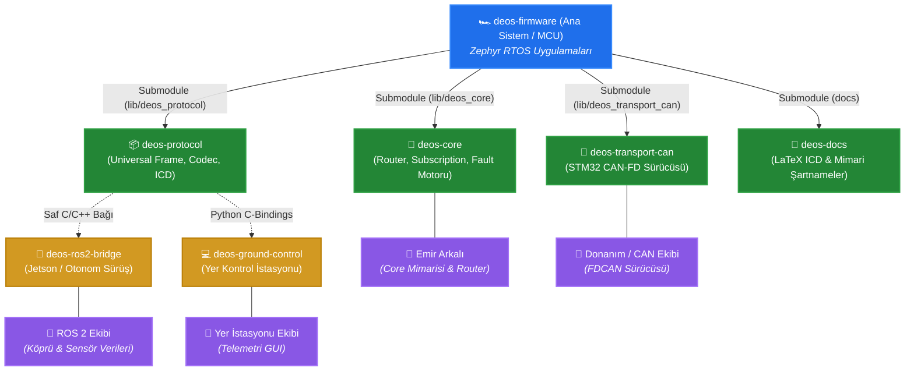

# DEOS Firmware

DEOS Firmware, Zephyr RTOS üzerinde koşan, modüler donanım mimarisine ve gelişmiş iletişim (CAN, LoRa, Ethernet vb.) altyapılarına sahip bir gömülü sistem projesidir.

Proje, donanım bağımsız (hardware-agnostic) bir yapıda geliştirilmiş olup, Zephyr'in **T2 Workspace Topology (Application as a Manifest Repository)** standartlarına tam uyumludur.

---

## 🏛️ Dağıtık Sistem Mimarisi ve Ekosistem Ağacı

DEOS ekosistemi; gömülü mikrodenetleyiciler (STM32), otonomi bilgisayarı (ROS 2), yer kontrol istasyonu ve dokümantasyon birimlerinin bağımsız yönetildiği modüler bir alt modül (Git Submodule) mimarisine sahiptir:



### 📦 Ekosistem Depo ve Modül Dağılımı

| Depo Adı | Tür | Sorumluluk Alanı | İlgili Ekip / Rol |
| :--- | :--- | :--- | :--- |
| **[`deos-firmware`](https://github.com/DEUDEOS-Team/deos-firmware)** | Ana Depo | STM32 Firmware Uygulamaları (`main_node`, `traction`, `steering`) | Tüm Gömülü Ekip |
| **[`deos-core`](https://github.com/DEUDEOS-Team/deos-core)** | Submodule | Zephyr RTOS Düğüm Motoru, Router, Telemetri Abonelikleri ve Hata Tablosu | Emir Arkalı |
| **[`deos-protocol`](https://github.com/DEUDEOS-Team/deos-protocol)** | Submodule | Ortamdan Bağımsız 9-Bayt Universal Frame, Serileştirme (Codec) ve ICD | Protokol & Ortak Ekip |
| **[`deos-transport-can`](https://github.com/DEUDEOS-Team/deos-transport-can)** | Submodule | STM32 FDCAN Donanım Sürücüsü ve 29-bit CAN ID Kodlayıcısı | Gömülü Donanım Ekibi |
| **[`deos-docs`](https://github.com/DEUDEOS-Team/deos-docs)** | Submodule | Resmi LaTeX ICD Şartnameleri ve Sistem Tasarım Raporları | Sistem & Dokümantasyon Ekibi |
| **[`deos-ros2-bridge`](https://github.com/DEUDEOS-Team/deos-ros2-bridge)** | Dış Sistem | Araç ile Jetson/ROS 2 Arasındaki Topic Köprüsü | ROS 2 / Otonomi Ekibi |
| **[`deos-ground-control`](https://github.com/DEUDEOS-Team/deos-ground-control)** | Dış Sistem | Telemetri İzleme ve Uzaktan Kontrol GUI / Test Betikleri | Yer İstasyonu Ekibi |

---

## 🚀 Kurulum ve İlk Adımlar

DEOS Firmware, kendi içerisinde bir Zephyr manifestosu (`west.yml`) barındırır. Bu sayede gerekli olan Zephyr çekirdeği ve dış modüller otomatik olarak indirilir.

Projeyi bilgisayarınıza kurmak için standart `git clone` **yerine** aşağıdaki Zephyr komutlarını kullanmanız gerekir:

```bash
# 1. Projeyi indireceğiniz yeni bir çalışma alanı (workspace) oluşturun
west init -m https://github.com/DEUDEOS-Team/deos-firmware.git deos_workspace

# 2. Çalışma alanına girin
cd deos_workspace

# 3. Bağımlılıkları, Zephyr çekirdeğini ve modülleri otomatik indirin
west update
```

Bu komutlardan sonra Zephyr ortamınız ve gerekli tüm modüller inmiş ve derlenmeye hazır olacaktır.

---

## 🛠️ Proje Yönetimi (Tavsiye Edilen Araç)

Zephyr projelerinin ortam kurulumu, derlenmesi (build) ve karta yüklenmesi (flash) gibi işlemler bazen karmaşık olabilir. 

Tüm bu süreçleri otomatize etmek ve geliştirme hızınızı artırmak için **[Zephyr Project Manager](https://github.com/emirarkali/Zephyr-Project-Manager)** aracını bilgisayarınıza indirip kullanmanızı şiddetle tavsiye ederiz. Bu araç sayesinde terminalde uzun komutlar yazmadan projelerinizi kolayca yönetebilirsiniz.

---

## 🧩 Overlay (Donanım Soyutlama) Mimarisi

DEOS projesi, kodların farklı donanım kartlarında (örneğin NUCLEO-H563ZI veya NUCLEO-H7A3ZI-Q) **hiçbir C++ kodu değiştirilmeden** çalışabilmesi için kusursuz bir Device Tree (Overlay) mimarisine sahiptir.

Projeye yeni bir donanım veya kart eklerken aşağıdaki kurallara kesinlikle uyulmalıdır:

### 1. `app.overlay` (İskelet Dosyası)
Uygulamanın ana klasöründe bulunur. Görevi sadece projenin **donanımdan bağımsız iskeletini** kurmaktır.
- Burada fiziksel pin atamaları **YAPILMAZ** (Örn: `&gpioe 14` yazılamaz).
- Hangi UART kanalının (`usart1`, `lpuart1` vb.) kullanılacağı **BELİRTİLMEZ**.
- Sadece uygulamada kullanılacak sanal modüller (node) ve etiketler (label) tanımlanır.

### 2. `boards/` İçindeki Overlay Dosyaları (Karta Özel Dosyalar)
Elinizdeki fiziksel kartın adıyla aynı olan dosyalardır (Örn: `nucleo_h563zi.overlay`).
- `app.overlay` dosyasında oluşturulan iskeletin, **sizin kartınızdaki hangi fiziksel pinlere** takıldığını belirttiğiniz yerdir.
- UART portu seçimleri, baud rate hız ayarları, CAN-FD RX/TX pin atamaları tamamen bu dosyada yapılır.
- Derleme sırasında (`west build -b nucleo_h563zi`) Zephyr, önce `app.overlay` iskeletini okur, sonra gidip `boards/nucleo_h563zi.overlay` içindeki fiziksel pinleri bu iskelete giydirir.

Örnek bir derleme komutu:
```bash
west build -b nucleo_h563zi apps/main_node
```

> **Not:** Sistem mimarisinin derinlikleri, ağ iletişimi (network routing) ve sıfır gecikme (zero-latency) optimizasyonları hakkında daha fazla bilgi edinmek için lütfen `docs/DEOS_ARCHITECTURE_KNOWLEDGE.md` dosyasını okuyun.
